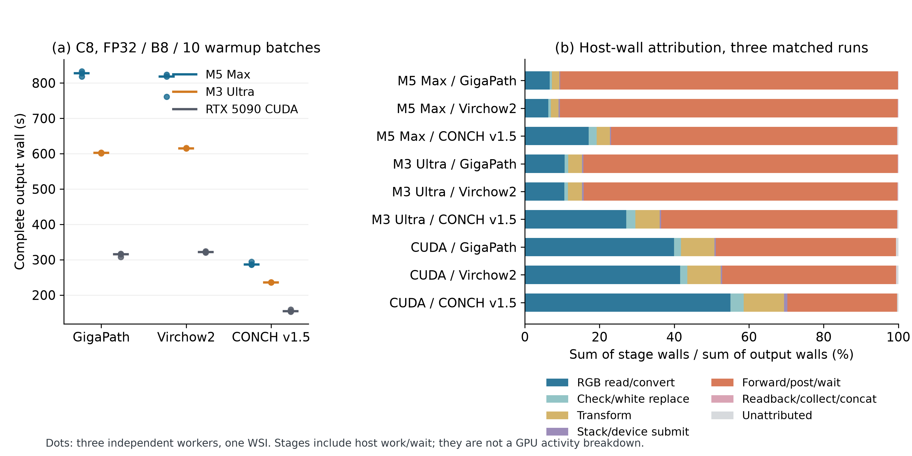
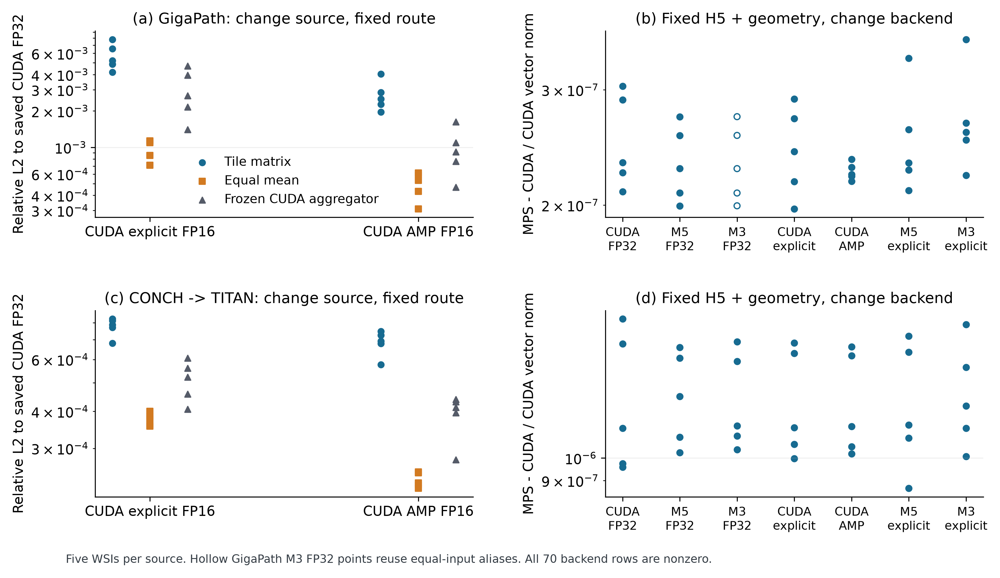
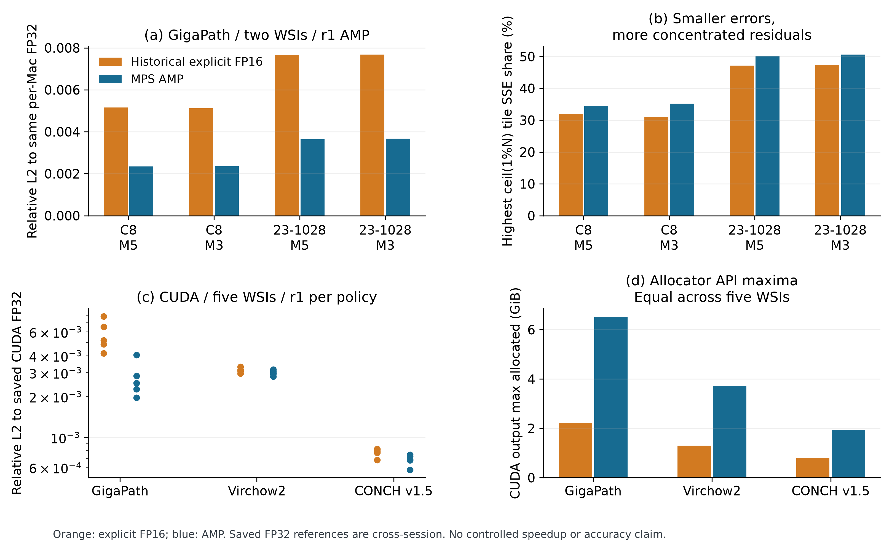

# Results: four engineering questions

Five engineering WSIs support the comparisons below; they do not estimate patient-level performance. [WSI sources](../../docs/WSI_INPUTS.md) · [Methods and reference directions](METHODS_AND_MEASUREMENT_CONTRACTS_EN.md) · [Data dictionary](DATA_INDEX.md)

## RQ1 — Time and measured resources

Historical M5/M3 ratios reversed with precision: all 90 WSI/model/batch FP16 ratios were below one and all 90 FP32 ratios above one for each retained endpoint. The configurations are dependent observations. Technical dispersion is reported in [per-condition repeats](data/Historical_Technical_Repeat_IQR_360.csv), [strata](data/Historical_Performance_Strata_72.csv) and [paired ratios](data/Historical_Performance_Paired_Ratios_144.csv).

For common-contract C8 FP32/B8 after 10 discarded warm-up batches, median complete-output seconds across three independent workers were:

[C8 = TCGA-C8-A26W](../../docs/WSI_INPUTS.md), with its existing recorded source identifier.

| Encoder | M5 Max/MPS | M3 Ultra/MPS | RTX5090/CUDA |
| --- | --- | --- | --- |
| GigaPath | 827.575 | 602.494 | 315.427 |
| Virchow2 | 818.613 | 614.780 | 321.342 |
| CONCH v1.5 | 286.473 | 236.024 | 154.508 |

GigaPath output CPU medians were 11.142%, 19.288%, 145.862% with one logical CPU = 100%. The combined forward/postprocess/end-wait host interval represented 76.60%–90.47% of summed output wall on M5, 63.21%–84.16% on M3, 29.39%–48.24% on CUDA; CUDA RGB read/conversion represented 39.94%–55.01%. These scope-specific observations do not isolate hardware, storage, kernel or saturation causes.

Figure S1. One C8 WSI, three independent workers/platform/model. Stage sums use matched output-wall sums; resource API scopes differ. [27 worker times](data/C8_Output_Times_27.csv), [raw stage walls](data/C8_Output_Stage_Raw_27.csv), [resource records](data/C8_Output_Resources_27.csv), [stage shares](data/C8_Stage_Shares_9.csv).

## RQ2 — Global consistency and local error concentration

Historical M3-candidate/M5-reference FP32 complete features were elementwise equal for GigaPath 5/5 WSIs, Virchow2 5/5, CONCH v1.5 0/5; all 15 coordinate pairs aligned row-by-row. Producing batch/repeat limits remain; this is not universal cross-batch determinism. Common-contract within-platform repeats were equal in all retained arms ([27 dependent pair records](data/C8_Repeats_27.json)). Cross-platform arrays could differ despite coordinate alignment.

For the original 23-1028 GigaPath pair (CUDA candidate, historical M5 FP32 reference), 103/10,244 highest-SSE rows contributed 99.8934% of total SSE. For later common-contract C8 (CUDA candidate, common-contract M5 FP32 reference), 144/14,344 rows contributed 96.8823%. Different pairs choose different top sets. Global proximity does not replace local tails, and highest SSE is not pathological importance. [Historical pair metrics](data/Historical_H5_Pair_Metrics.csv), [C8 comparisons](data/C8_Comparisons_9.json), [retained cutoffs](data/SSE_Selected_Cutoffs_18.json).

Training precision does not explain this model-dependent equality pattern: Virchow2's author model card reports FP16 mixed-precision training and its paper v3 Table A2 records FP16, yet its retained FP32 inference arrays were equal. Stored equality does not prove identical intermediate tensors, operators or rounding. No pure-FP32-training cause is assigned to GigaPath, nor a training-precision cause or quality ranking to CONCH v1.5. Input processing, operator implementation and execution conditions were not isolated. Sources: [Virchow2 model card](https://huggingface.co/paige-ai/Virchow2), [versioned paper](https://arxiv.org/html/2408.00738v3).

## RQ3 — Source replacement versus identical-input backend replacement

| Counting unit | Coverage | Meaning |
| --- | --- | --- |
| Tile/fixed-mean source references | 5 WSIs × 3 models × 7 sources =105 | Saved full-bag means; not 105 independent WSIs or new executions |
| Learned source/backend/call reference cells | 280, including 20 GigaPath M3F aliases | 260 distinct physical output paths; aliases are not additional forwards |
| Same-lifecycle repeat rows | 140 /130 distinct physical pairs | All equal; not general determinism |
| Same-input MPS-minus-CUDA rows | 70 /65 physical pairs | All non-equal; relative denominator is CUDA norm |
| Fixed-backend source comparison rows | 180 | Nine axes × 5 WSIs × 2 models × 2 backends |
| Tile/mean/learned parallel rows | 135 | Nine axes × 5 WSIs × 3 tile models; Virchow2 learned N/A |

Same-input backend relative L2 ranges were 1.97452e-7–3.58190e-7 for frozen compatible GigaPath and 8.68202e-7–1.90768e-6 for TITAN. Source substitution and backend substitution are different axes; per-representation norms do not define a universal amplification factor. Three C8 tile fields remain unavailable in M3F-minus-M5F direction; opposite-direction results do not supply the same relative-L2 denominator. The Mac AMP observations concern two GigaPath tile conditions and have no learned-aggregation measurements.

Figure S2. Five WSIs; named source/representation and fixed-H5 backend axes. GigaPath M3F/M5F input aliases disclosed; zero/equal results counted in tables, not replaced by pseudocounts. [Coverage and aliases](data/Seven_Source_Coverage_Overview_15.csv) / [input relationships](data/Seven_Source_Input_Relationships_105.csv), [repeat140](data/Same_Input_Repeats_140.json), [backend70](data/Same_H5_MPS_minus_CUDA_70.json), [source180](data/Same_Backend_Source_Pairs_180.json), [parallel135](data/Propagation_135.csv).

## RQ4 — Explicit half and AMP against one FP32 reference

CUDA AMP had lower global relative L2 in all 15 WSI/model conditions: reductions 48.15%–56.53% for GigaPath, 3.11%–5.40% for Virchow2, 9.18%–15.49% for CONCH v1.5. However, AMP max_abs was higher in 5/15 conditions and worst-tile cosine lower in 6/15; CUDA allocator maxima were higher. It is not an all-metric improvement.

Mac GigaPath AMP reduced same-reference global relative L2 by 52.22%–54.59% across the four WSI/Mac conditions. Absolute errors fell while residual top-one-percent SSE shares increased. The error reduction is a numerical metric, not retained accuracy. AMP output seconds on M5/M3 were 477.027/589.285 for C8 and 227.679/416.195 for 23-1028, r1 only. Historical producing timings are unbound; sessions/OS/adapters/observers differ, so these are not controlled precision speedups.

Direct Mac AMP arrays were non-equal on both WSIs. M5 AMP candidate minus M3 AMP reference relative L2 was 0.0009750596166116895 (C8), 0.0013388880426934756 (23-1028); minimum tile cosine 0.9998809660622883/0.9998635106718933 and independently selected top-one-percent SSE share 25.47389294%/38.53908134%. Coordinates aligned; the actual reference direction is retained. FP32 equality and AMP inequality apply to their specific retained policies, not all internal execution states.

Figure S3. Same-FP32-reference numerical errors; independent SSE tails; scope-specific CUDA allocator maxima. Mac four r1 observations and five-WSI CUDA conditions remain separate. [CUDA15](data/CUDA_Same_Reference_Policy_15.csv), [full CUDA75](data/Core5_Tile_And_Mean_75.json), [Mac same-reference4](data/Mac_AMP_Same_Reference_4.json), [direct Mac AMP2](data/Mac_AMP_Direct_CrossMac_2.json), [Mac timing/resources](data/Mac_AMP_Time_Resources_4.csv), [CUDA timing/resources](data/Core5_CUDA_Timing_Resources_30.csv).

## Interpretation and limits

These are descriptive answers for the stated inputs and contracts. Global error reductions and more concentrated residual error can coexist; model output scales differ, so max_abs does not rank models. No kernel cause, universal optimum, safe clinical tolerance or causal precision speedup was established. DistillPath already reports MPS/CUDA encoder-forward efficiency; PathPool reports serving/shared-memory engineering and output consistency; TRIDENT/Slideflow provide WSI processing frameworks. The empirical extension here combines complete-output/resource boundaries, global and local discrepancies, separate propagation axes and same-reference precision tradeoffs. [Primary references](REFERENCES.md) and [methods](METHODS_AND_MEASUREMENT_CONTRACTS_EN.md) define the scope.
